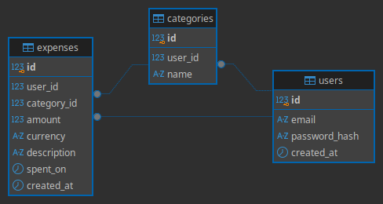

# Expense Tracker API

Backend sustav za praćenje osobnih troškova, izgrađen u Pythonu (FastAPI) s PostgreSQL bazom.
Projekt je nastao kao praktični način učenja modernog backend razvoja, od osnova do deploya.

## Što sustav radi

- Registracija i prijava korisnika (JWT autentikacija)
- CRUD nad troškovima i kategorijama
- Mjesečni izvještaji po kategorijama
- Pretvorba valuta putem vanjskog API-ja
- Caching izvještaja (Redis)
- Automatski mjesečni sažetak (background task)

## Tech stack

| Područje | Tehnologija |
|---|---|
| Jezik | Python 3.12 |
| Framework | FastAPI, Pydantic |
| Baza | PostgreSQL, SQLAlchemy, Alembic |
| Cache | Redis |
| Testiranje | pytest |
| DevOps | Docker, docker-compose, GitHub Actions |
| Deploy | [Render / Fly.io / AWS] |

## Pokretanje (lokalno)

```bash
git clone https://github.com/TVOJ_USERNAME/expense-tracker-api.git
cd expense-tracker-api
python -m venv .venv
source .venv/bin/activate
pip install -r requirements.txt
```

Upute za pokretanje aplikacije bit će dodane s prvim endpointima.

## Struktura projekta

- `app/routers/` HTTP endpointi
- `app/services/` poslovna logika
- `app/repositories/` pristup bazi
- `app/models/` SQLAlchemy modeli
- `app/schemas/` Pydantic sheme
- `tests/` automatizirani testovi
- `sql/` shema baze i izvještajni upiti

## Shema baze



## Autor

[Tonino Turato] 